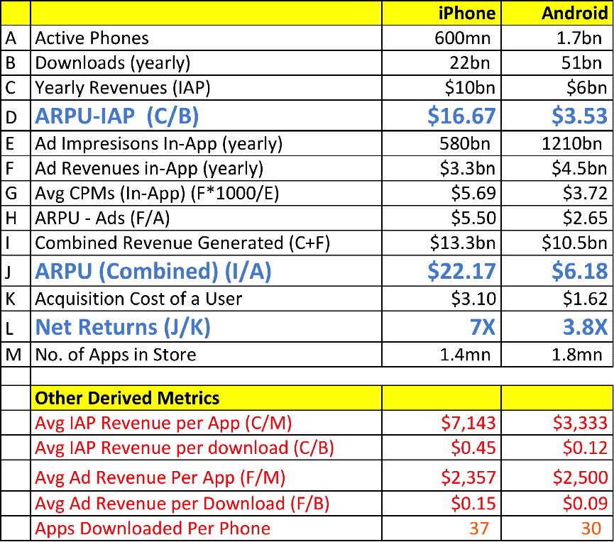

The metric of choice for comparing iOS to Android is average revenue per user, or ARPU (spoken phonetically exactly as you'd guess). This is fine, it is certainly technically accurate, but it isn't exactly relevant for most of the discussions where it is used as ammo. It's like comparing the average revenue per user of all car buyers vs. only Ferrari\* buyers – it tells you what you already know.

Notice how I didn't say Hyundai vs. Ferrari, that would be a hyperbolic falsity, I specifically said all cars because that's much more aligned with the reality of Android. You need to understand the Android spectrum to fully appreciate the volume, human impact, and glory of what they've pulled off.

This graphic shows the ARPU comparison between the platforms, it is interesting data, but remember to keep perspective on the topic (<a href="https://medium.com/its-an-app-world/march-2015-iphone-vs-android-monetization-capabilities-you-won-t-believe-who-won-7a02fde2dc2" target="_blank">source article</a>).

Android vs. iOS ARPU vs Deepak Abbot on Medium

Now some considerations and perspective:

- Note the ARPU difference and relationship in app sales vs. ad revenue. 
- Android has been installed on a *lot* more phones than iOS. I am basing this on <a href="http://www.businessinsider.com/iphone-v-android-market-share-2014-5" target="_blank">data that is getting old</a>, but I don't think enough has changed to change the blunt fact that Android dominates on pure install base – Android had (Q4 2013) 78% market share to iOS's 18% worldwide. The data above shows a 74/26 split purely between these two platforms. Before you get angry at the mention of install base metrics...
- Install base doesn't mean much of anything for any discussion aside from install base discussions.
- There are many millions of Android device owners that don't own a computer or have another source of Internet in the home, the phone *is* their first and only computer and their connection to the web.
- There are Android users who don't have running water, plumbing, or electricity at home. Communities have communal charging stations on the side of the road. <a href="https://twitter.com/BenedictEvans/status/583489997203869698/photo/1" target="_blank">Benedict Evans</a> does a great job of tracking and tweeting (<a href="https://twitter.com/JamesKaiser_/status/583691474421719040" target="_blank">or retweeting</a>) data and <a href="https://twitter.com/greengart/status/583631616985149441" target="_blank">anecdotes</a> about this. Can you imagine <a href="https://twitter.com/jadutwit/status/583499249402454017" target="_blank">walking a day or more just to charge your phone</a>?
- Android devices are connecting people from the third world to services and communities that allow them to catapult their communications capabilities forward by decades.

There isn't *one* smartphone market. You can make it look like a single market on paper, but the reality is there are several markets. I would love to see data on premium device ARPU broken out by region, this would be a more valid comparison to make. There are hundreds of millions of Android devices that are in the same premium segment as iPhones, and there are old hand-me-down iPhones that are in a similar segment to lower end Android (though I don't believe even the bottom of the iPhone spectrum reaches the price points/capability of the low end Android phones). These devices have changed the world overnight unlike anything most of us have ever seen.

Next time you pull out your device of choice and think that you can't live without it, remember that there are millions of people for whom their smartphone is fundamentally changing the <a href="https://twitter.com/TProphet/status/581580595047731200" target="_blank">entire trajectory of their family's livelihood</a>. Apple and Google have enabled extraordinary things with their platforms and there is no question about our love for and dependence upon our phones. However to compare the two platforms outright as one market is a fool's errand without maintaining perspective on the extraordinary differences between what the platforms (or even subsets of each platform) enable.

*\*I picked Ferrari because I originally picked Audi and then started questioning whether the revenue from super cars would actually be enough to offset the lower end cars and render my analogy dead in the water. Rather than picking Audi and doing the math, I went with a car I knew would represent a huge ARPU that the car industry as a whole couldn't touch.*
