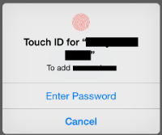

Touch ID has brought a level of convenience, speed, and security to consumer electronics that has never been seen before. Your fingers are always with you, they're unique, and the fingerprint recognition is incredibly fast. In addition to that, an image of the fingerprint itself is not stored on the device, and what *does* get stored is kept in an ultra-secure enclave within the phone - never sent over the Internet. Each of these pieces is fundamentally critical to enabling mainstream adoption of two factor authentication. If the scanning were slower or less reliable, even only slightly, that could be enough to invalidation my entire assertion below.

Right now you've got people who not only avoid two factor authentication, many use the same password for everything, store passwords in a text file, use really simple and obvious words, or any number of other terrible practices. Then if they're hacked, they are surprised. Whether we like admitting it or not, the fact is that without an extraordinary amount of convenience, more secure practices will not become commonplace. 

### The Potential

Apple has an opportunity to make two factor authentication commonplace; hopefully it will be instilled as a societal expectation that a hardware vendor provide a secure solution on par with this, but that's getting ahead of myself. So what does this hypothetical two factor authentication using Touch ID look like?

Apple releases an API so that websites support two factor authentication with Touch ID. When you log into the website with a username and password a request is sent to the device of your choosing, let's say an iPhone for now. Your phone lights up with the standard Touch ID authentication push alert with some basic information about the website that is making the request. Your fingerprint is never sent over the network, let alone to a third party website, but instead (much like third party apps in iOS 8) a simple "yes" or "no" is sent back to verify the user.

The push alert appears within a second or two, the scan doesn't require unlocking the device or anything, and in fractions of a second the fingerprint scan completes. Done. You now have an account that is nearly impossible to access without your permission (assuming the third party doesn't have some security loophole elsewhere).

Ultra fast. Ultra secure. Ultra convenient. Easy to understand and setup. *It just works*.

### Longer Term

Longer term you could take this a step farther and include the Apple Watch. Right now, once authenticated, the Apple Watch doesn't require a PIN until contact with the skin is broken. Eventually the sensors on the back of the watch might to be able to use your biometrics (blood pressure, heart beat pattern, etc.) to create a unique identifier for you. The two factor authentication could be as simple as tapping "yes" on your watch face since the device already knows it is you.

### What's the Hold Up?

There is nothing stopping Apple from doing this today. The hooks are already built into iOS to enable the Touch ID prompt from a third party. The API and third party implementation of the API is really the only big piece missing. It isn't trivial, but it is well within the scope of realistic.

One important consideration is how do you manage the situation where you've lost your phone? That's a tough one, likely a recovery password coupled with something else, maybe even a webcam based facial recognition option (which also has drawbacks). This isn't a perfect solution, but the benefits vastly outweigh the drawbacks as far as I can tell.

### Closing Thoughts

I think Apple has a lot to gain here (for their image alone, if nothing else) and they're in a position to educate users how to take better care of their digital belongings. I cannot imagine any process that is more convenient that offers even a fraction of this level of security. Apple would be wise to roll this out as soon as possible, especially now that Touch ID equipped devices are numbering well into the tens of millions. I know I would use it for nearly everything, and I think this just might be enough for the average person to *want to* protect themselves.
