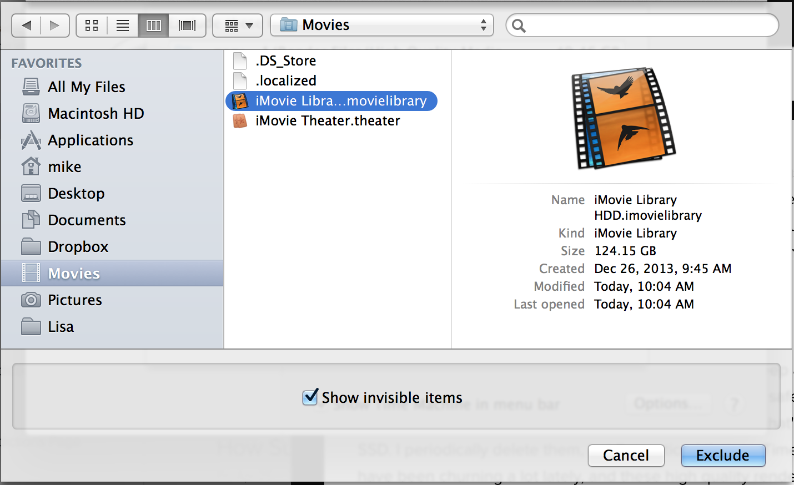

Time Machine and Backblaze team up to make a really robust backup configuration for any Mac user. They offer features to exclude particular directories from the backups, but what happens when those directories are inside of a "package" such as your iMovie or iPhoto library? If you use the UI to do this, you'll never be able to omit a subdirectory of a package, but luckily  there is a very easy solution.

### The Problem

Working with iMovie lately I've realized that it tends to keep a lot of high quality render files around. There is no way to limit them, and they're totally safe to delete. In my case, I'm generating 50-75GB of these files per hour I edit video, that's a problem on my little 500GB SSD. I periodically delete them, but I've noticed that my Time Machine and Backblaze backups have been churning a lot lately, and these high quality renders are the reason.

### The Solution

The solution is easy. We'll cover how to do this in Time Machine, it is done in Backblaze in the exact same way. This works for any package content, in this example we'll use the iMovie High Quality Media directory we've been covering.

If you use iMovie, click on your iMovie Library and select "Show Package Contents". Then navigate (per project) to \<project\>/Render Files/High Quality Media. 

Open your System Preferences, select Time Machine, select Options, click the plus sign to add a directory. Navigate to the location of your iMove Library and you'll notice that it is a package, not a directory (packages are really just special directories). It will look like this.

Open your Finder window just next to it, and drag and drop the "High Quality Media" directory into this exclude window; click "Save"/"Ok", that's it, you're done. You'll want to do the exact same thing for Backblaze. 

Hope this helps you as much as it has helped me!
