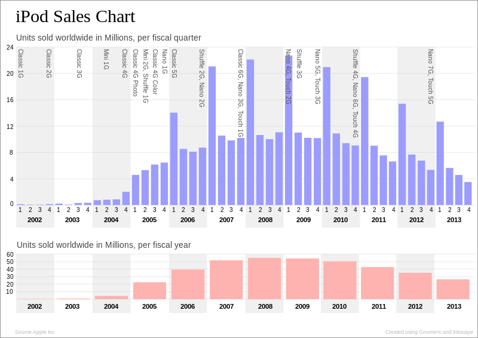
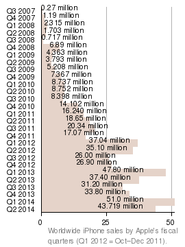
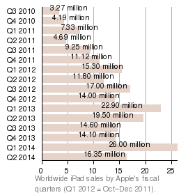

The iPod, iPhone, and iPad are unequivocally considered to be profound and world-changing technological breakthroughs that forever changed the world we live in. They sell by the millions and account for staggering quarterly revenues.

The funny thing is, none of them really sold well on the first generation. The first iPod is barely a blip on the sales radar coming in well under a quarter million units.

Image credit: Wikipedia

Okay, so what about the iPhone? Nope - 270,000 units in their first quarter. Sales did pick up a bit for a total first year sales of a little over 5M, but they sell that on opening weekend now.

Image credit: Wikipedia

Fine, but surely the iPad was a grand slam, right? Comparatively, yes (at 3.27M units the first quarter). But by today's standards? Not so much.

Image credit: Wikipedia

So what exactly are "today's standards"? Every time there is a new sales record, that seems to become the new standard. If a company returns to their previous normal revenue, normal sales, or normal product volumes it is usually viewed as the end of days for that company. Growth is important, don't get me wrong, but Apple's repeatedly mind-boggling quarterly revenues are dismissed because some of the growth numbers are flat.

[I've written about the flat iPad growth](http://www.opte.ch/news/2014/4/21/a-different-interpretation-of-gasses-ipad-numbers) and so has [Ben Thompson](http://stratechery.com/2014/dont-give-ipad/), so I won't rehash it, but suffice it to say they're selling a lot of iPads. The speculation for their next product is, well, creative to put it nicely. Many things are products that could certainly be interesting, but often many don't address a real problem like these iDevices did. This tweet from Benedict Evans hits the nail on the head.

> Before the iPhone and iPod we knew the problem but not the solution. With smart watches we don't know the problem
>
> — Benedict Evans (@BenedictEvans) [April 19, 2014](https://twitter.com/BenedictEvans/statuses/457553325324386304)

Apple's next product could be a health wearable where the total addressable market is technically every human, but realistically far, far smaller. It could be a watch. It could be television. Each of these has inherent problems, but did many of their past breakthrough products, all of which were overcome.

Suppose Apple does the Apple thing and overcomes the battery life or content delivery or whatever hurdles stand in their way. Suppose they introduce the next leg of their product stool at WWDC in a few weeks. What happens then? Is there any sales number that would draw a positive result from the masses? They sell 50M iPhones per quarter, so do they have to beat that? It sounds insane, but after seeing the 50M number, 1M doesn't sound so good to those that are so hungry for something, *for anything* new, that they live with blinders on and won't stop writing about how innovation is dead at big companies like Apple.

If it isn't the sales number that gets people, perhaps it'll be the revenue. As Ben Bajarin has pointed out several times, for any product to even show up on their revenue pie chart it would have to make many billions of dollars. That's a stretch, even for Apple.

I certainly hope a new product is met with new (and realistic) sales volume expectations, but I'm not holding my breath. News agencies are pushing this sense of urgency that a monumental breakthrough is absolutely required for Apple as we know it to stay relevant. Once the stimulus bar has been raised, it (apparently) can never go back down.

What is the magic number of unit sales or revenue they've got to hit? Will it even matter, or will the next round of pessimists start immediately beating their tired drum? Only time will tell.
