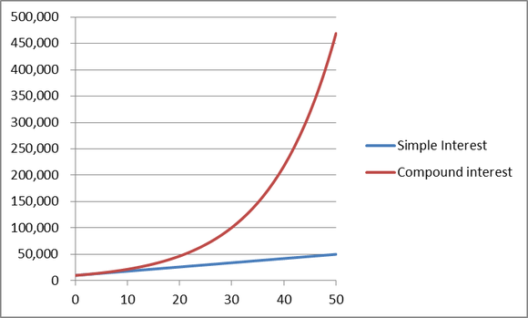

It doesn't matter if you are a tech lead for a small group of developers or a manager of a large team of engineers, there are a number of practices that will drastically improve the results you end up with. Naturally, this can't capture every aspect of good management, there are hundreds of books that do that in a more exhaustive way than I ever could, but I have personally seen each of these be the difference-maker with regard to how a team is able to execute.

## Intelligent Communication

It seems so obvious, but it is still far too common to see over-worked leads declare that they're too busy to help ramp up a new engineer, or a manager fighting a fire that's too busy to give an adequate summary of the program, the goals, the deadlines, and the expectations. The heading is "Intelligent Communication" because this shouldn't be a static, one-way, experience. Important things need to be communicated, such as the aforementioned timeline, expectations, roles and responsibilities of team members, etc., but that ignores the benefits to be gained from a more dynamic exchange between the employee and leader.

Some engineers can get sufficient answers from a quick email and have plenty of relevant past experience to just hit the ground running, but that hasn't frequently been my experience. It is the responsibility of the manager or lead to understand how to most effectively communicate with this new asset (also, don't forget, a human), because if the communication is done well, and if the person is a good hire (more on this below), then an investment in this early communication will yield compounding returns on the investment. For example, just because you assert, albeit correctly, that communication bandwidth decreases as you go from face-to-face, to video, to the phone, to Slack, to email, doesn't mean that the highest bandwidth solution is always the mainstay of optimum communication – some people don't learn well or retain information provided to them verbally. 

Now, with that said, an in-person meeting has the advantage of making it easier to identify whether the current communication style is working and enables you to switch on the fly from a casual chat, to a whiteboard discussion, to a prepared presentation, or even to hands-on working an example problem together. This is harder to achieve remotely, especially without video, because it is harder to read the body language of the new employee.

Being able to identify these communication styles and then being able to adapt to them is why I launched the <a href="/speaking" target="_blank">Speaking</a> section on my website, this is something I feel very strongly about, and I have seen successes and failures underscore the importance. 

## Adapting to Learning Styles

Perspective is one of the great biases that everyone struggles to overcome, but some are more successful than others. It holds true in everything from politics, to relationships, and it most certainly applies to leadership. There are two main ways in which perspective can prevent a leader from being a great leader – letting prior knowledge distort the their view of where the new employee will start from, and the inability to abandon the leader's learning style and adapt the communication to the new employee's style.

### Prior Knowledge

A person that has been working on a project for 1, 3,  or 5 years (and the problem only gets worse with time) doesn't have a great understanding of what it is like to start fresh. It isn't only that they have already setup their computer with the right tools, made sure the code compiles on their machine, knows they have access to the internal Wiki/Confluence page (if it exists, and it ***should*** exist); the problem is deeper than that.

The product has been developed and matured in a way that corresponds with how the experienced person thinks and works because they were the one building the product. There are standards for structuring code or building bridges, but there is always a personal touch, so even something as simple as where to find the heart of a piece of software logic seems so obvious to someone who has been doing it all day every day for years. Can you remember what it is like to not know how to tie your shoes?

This is one reason it is so critical to document your trials at each stage, but especially ramping up on a project, on a Wiki/Confluence page so that as each person goes through the start-up process, it gets gradually easier because the documentation improves. The person before them has documented everything they struggled with, same with the person before them, and with each iteration the sharp corners get sanded down and ramp time is decreased. This does two key things: it builds institutional knowledge within the team and it gives the leader the appropriate "rookie" perspective when they look back through what was documented. They will see all sorts of information that seems so obvious ("well of course that's where the code is saved, duh!") and it will help them realize the perspective of the new engineer.

### Learning Styles

There are <a href="http://www.learning-styles-online.com/overview/" target="_blank">seven learning styles</a>, and each of us has strengths and weaknesses when it comes to what works for us. One of the biggest mistakes I see, after the perspective issue we just discussed, is the failure to recognize learning styles and adapt to them. A leader's job is to enable and guide their team toward success (and to clearly define success, among other things). It is ignorant to think that simply dumping a pile of information in front of a new employee is sufficient to get them started.

How would you feel if a tax expert just dumped the IRS rule book on your desk and just walked away? If you're a person who learns well from books, what about having no literature at all, but instead having a quick 10 minute phone call to get spun up on a new project and the notes you're franticly taking on the phone aren't sufficient? There is no way to replay or revisit that phone call to see what you missed (unless you record it, which, if is clear to the other party, can be a valuable strategy). This is why having training materials and procedures for each learning style is so valuable, and this isn't nearly as daunting as it sounds. No one expects seven copies of training material, one focused at each learning style. Instead cover the basics, then adapt the delivery and mentoring process to cover the rest of the gap.

Most managers fall victim to the bias we all start with – our learning style works great for us, therefore it is a great method for teaching. I have seen instances where two equally capable engineers with different learning styles were placed on a team together where one succeeded and another struggled; eventually a good engineer will find the path to success, but if that takes an extra six months, that isn't just six months of productivity lost, it is six months where your compounding returns are applied to a much smaller principle investment. And we have all seen how crucial early investment is when it comes to compounding returns.

Identify their learning style up front, then adapt. If they don't know their learning style, help them <a href="https://www.how-to-study.com/learning-style-assessment/" target="_blank">figure it out</a>, it will benefit you both. When you encounter a learning style that is entirely foreign to you, you can either use it as an exercise to grow or you can find another engineer on your team who might be better suited to mentor this person. This is where having a diverse team is so powerful, you cover your bases on past experience, perspective, learning styles, and everyone sees the benefits.

## Hiring Intelligently, Then Trusting Them

Hiring intelligently seems obvious, yet the reality is it doesn't happen as often as we'd like and it always feels like you're rushed to fill a position. All too frequently, hiring decisions are rushed because suddenly there is a need, or because your job opening might get pulled out from under you if you don't move fast enough. There is a huge difference between hiring the *right* person for the job and hiring the best person you were able to find that month. There are realities that come into play, often there is absolutely nothing you can do about the fact you need an employee immediately and the talent pool you're drawing from isn't as full as you'd like. If you're in this position, it is already too late for this hire.

I plan a more thorough dive into hiring in another post, because it is a fascinating topic with extraordinary challenges, but this quote captures it beautifully.

> “Steve Jobs has a saying that A players hire A players; B players hire C players; and C players hire D players. It doesn’t take long to get to Z players. This trickle-down effect causes bozo explosions in companies.”

— Guy Kawasaki (summarizing Steve Jobs)

It is so important to hire A players, because those are the people who will do the next round of interviews and hiring. I have seen this play out more than once, and there is truth to it. Now, it bears mentioning that not all A players are good at hiring, the interview process is a deeply challenging problem to solve, but let's assume you've got a good process and you're finding good people. Keep in mind that "A players" aren't defined in the same way everywhere, so make sure to define what an "A player" is for your team. **(See update.)**

TRUST THEM TO DO THEIR JOB!

Now that we have the yelling out of the way, I'll say it again, ***trust your team to do what they were hired to do***. Despite the best efforts of many intelligent people, often engineering managers became managers because they were the best engineers who had been around the longest when there became a need for a manager. This is a bad practice for a lot of reasons, one of which is that these "best engineers" usually think they know exactly how to solve a problem and their way is the best, so when someone on their team tries a different approach, they pull executive override, or they micro-manage. This is not a recipe for success.

Employees need guidance and leadership, so this doesn't mean you should just let them roam free, but you either trust the engineer to do their job or you don't, and if you don't, you should not have hired them. If that trust never comes, they need to be let go. It is far more toxic to keep around an employee that managers and colleagues cannot trust to have their back than it is to let them go.

When there is an employee that other team members cannot trust, you have a choice, and the result will send one of two messages.

1.  I trust my team at large and I have your back, I will make the hard choices to enable my team for success, or...
2.  I don't have your back, I don't value my team over how hard it is to let someone go.

You should be able to trust everyone on your team up to their current level of responsibility and be looking to grow that trust up to their next level of responsibility. If this is ever untrue, or the trend line is pointing in the wrong direction, it is time for a hard decision, that is an unavoidable truth of good leadership.

## Closing Thoughts

This post ended up being longer than I expected, I just wanted to touch on each of these topics briefly because of how crucial they are to being an effective leader. Most of these principles hold true for all types of managers, not just engineering leadership, but I figured I'd try to keep this within the realm of my own experience or that which I have personally observed.

Please feel free to <a href="/contact" target="_blank">get in touch</a> if you think this struck a chord, we can get a cup of coffee to discuss a strategy to bring this up to a wider audience at a board meeting or with engineering directors, depending on the size and structure of your company. I guarantee satisfaction, so if you're interested, check out more about my <a href="/speaking" target="_blank">speaking engagement offerings</a>.

### Update

I have <a href="https://www.opte.ch/news/2016/12/7/how-to-hire-computer-and-software-engineers" target="_blank">published a piece</a> on hiring and interviewing where I clarify what was alluded to here, but for the sake of clarity, I will highlight that there is no causal relationship between being a good engineer and a good interviewer, nor vice versa.
