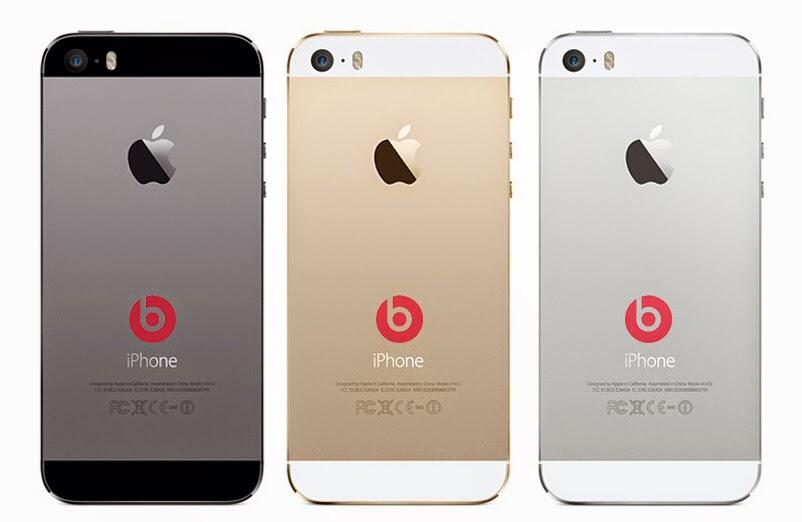

I [wrote a piece yesterday](http://www.opte.ch/news/2014/5/8/doesnt-add-up-rumors-on-apple-purchasing-beats) after news broke that Apple is near closing on a deal that would make them owners of Beats for a bit of spare change, \$3.2 billion. I highlighted a few reasons why this doesn't seem to add up, and those are still valid.

Reports seem to be hinting more and more strongly that this is legit, but it still isn't quite settling right for me. In one camp, you've got those that believe the headphones are the primary driver for the deal ([Ben Thompson](https://twitter.com/monkbent/status/464629787412004864) for one). In another (perhaps larger) camp, you've got those that think it is for the music streaming service.

Both of these are valid thoughts, but both have major hurdles. It would make sense that the purchase is likely to be for both products, if it is real at all, otherwise they'd spin off (or not sell) the other half I would think. Tough to say for sure.

### Headphones

If the deal is primarily for the headphones, the biggest problem I see is the brand. The Beats brand is valuable as a brand. People know it, people love it, and people are willing to spend a lot of money on it despite the obviously inferior sound quality. They sound "good enough" (audiophiles disagree) and look good enough that people want them. They've become an icon. You don't have that without the Beats brand, and when was the last time Apple sold their own product with any hint of any other brand on it? There is just no way you will see something like this happening...

How valuable would Beats be without the brand? If they wanted headphone technology, why not purchase Sennheiser or someone like them?

### Music Streaming

So what if this deal is for the music streaming? iTunes Radio isn't exactly sweeping the industry by storm like iTunes did, so that might make sense, right? Well, maybe. The biggest concern is that the content rights that Beats managed to get that Apple hasn't managed to obtain for themselves [aren't transferable](http://daringfireball.net/linked/2014/05/08/beats) (most likely) in the event of an acquisition. Add to that the fact that Beats Music only has [around 200,000 subscribers](http://mashable.com/2014/05/08/apple-beats-not-headphones/), and you've got a much harder time justifying a \$3.2 billion deal.

### Video Leak

This morning, a [video was posted](http://thenextweb.com/apple/2014/05/09/dr-dre-just-confirm-apple-buying-beats-3-2-billion/) on Facebook by Dre himself that "confirmed the deal" was happening. That makes this all seem more like a joke than anything as Apple doesn't usually stand for that kind of thing. If the deal was happening, I'd think such a slip up could certainly jeopardize it.

### Closing Thoughts

I stand by my prior conclusion, despite the fact that online news sources seem to be more convinced by the minute that this is imminent. If this deal is real, there's a *major* piece we're all missing. Otherwise, I just don't see the value in it for Apple.
