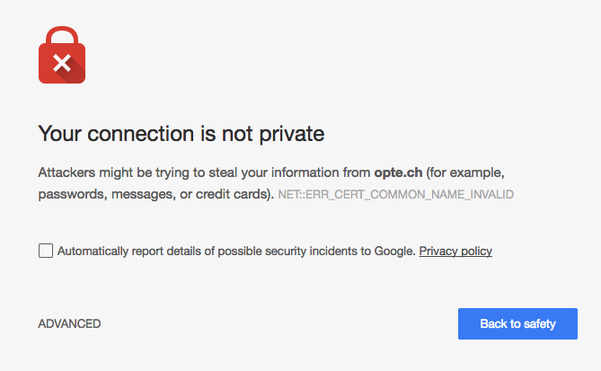

It is long overdue, but given the nature of the website (not asking for any of your personal information) I hadn't found the time to set it up. That said, OpTech now defaults to HTTPS ensuring you have a secure connection.

Please contact me, via <a href="https://twitter.com/optechmike" target="_blank">Twitter</a> or the [Contact](/contact) page, if you're seeing any issues or getting any HTTPS warnings from Chrome or another browser. Warnings like the one shown below are NOT expected.

