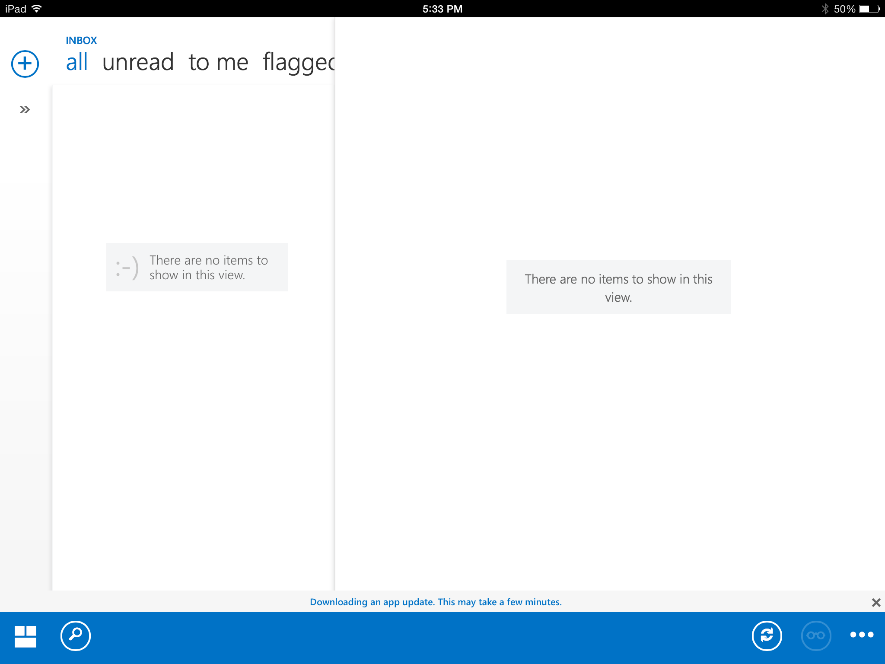
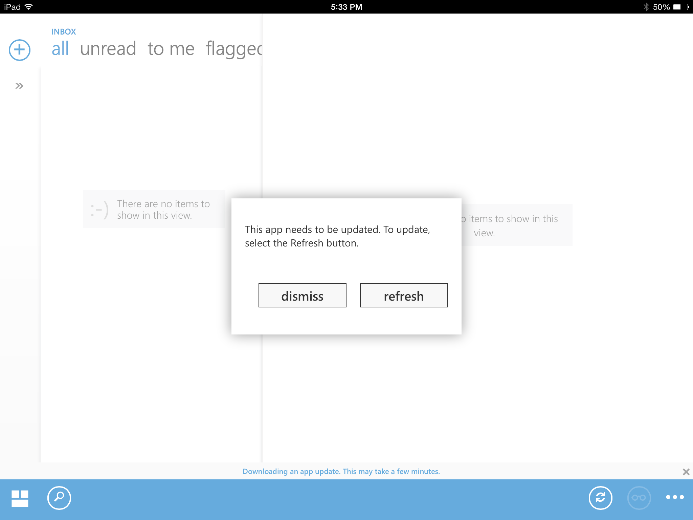

I'm a slave to Outlook and OWA for work, no way around it. I use the native iOS email app on my (work-issued) iPhone. On my personal iPad, which is rarely used for work, I use the official [Microsoft OWA](https://itunes.apple.com/us/app/owa-for-ipad/id659524331?mt=8) (Outlook Web Access) app. I launch the app 0-4 times per day, usually 1 or 2. Approximately 10-25% of app launches result in this update state where I cannot do anything, I must wait (look at the banner along the bottom):

So I wait. Usually about 60-90 seconds. When it finishes? You guessed it, the good ol' fashion Windows-style reboot.

It is a shame. The app is fairly well designed, though there are some glaring usability flaws. This isn't new, and this isn't temporary. I've used this app since October 2013, here we are 6 months later with no fix or update.

If you're at Microsoft, you've got to ask who is signing off on this quality of work.
