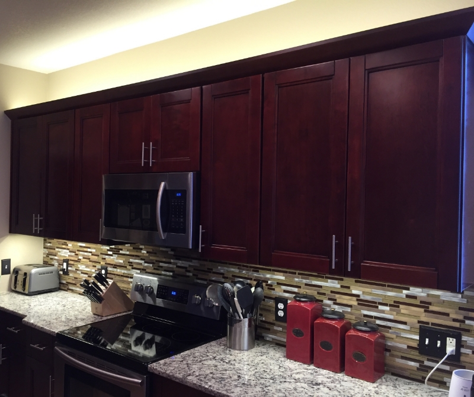
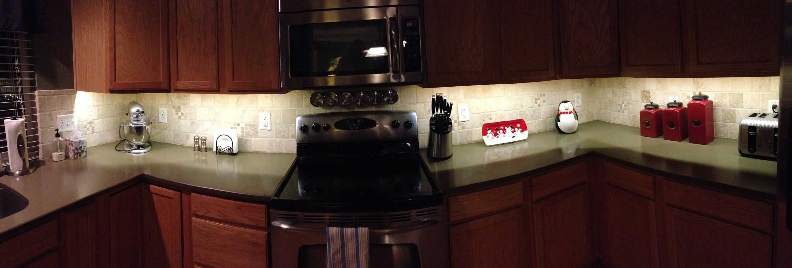

This is somewhat outside the scope of this blog, but if you love tech stuff, you probably love LEDs. I love LEDs. I recently completed the installation of LED light strips in my kitchen to improve counter lighting and for ambiance, wanted to share what I used and a few things I learned.

### Materials

- LED Light Strips - 3100K, double density (<a href="http://www.amazon.com/gp/product/B00710K0DE/ref=oh_details_o04_s00_i01?ie=UTF8&amp;psc=1" target="_blank">link</a>)
- Power Supply (<a href="http://www.amazon.com/gp/product/B003WOIVRU/ref=oh_details_o04_s00_i03?ie=UTF8&amp;psc=1" target="_blank">link</a>)
- Wire (<a href="http://www.amazon.com/gp/product/B001JT76C6/ref=oh_details_o04_s00_i02?ie=UTF8&amp;psc=1" target="_blank">link</a>)
- LED Strip Connectors (<a href="http://www.hitlights.com/3528conntwhd.html" target="_blank">link</a>)
- Dimming Switch (<a href="http://www.amazon.com/gp/product/B008CRIVR2/ref=oh_details_o02_s00_i00?ie=UTF8&amp;psc=1" target="_blank">link</a>)
- Conduit/Raceway (<a href="http://www.homedepot.com/p/Wiremold-Legrand-Cordmate-Kit-White-C110/100657471?N=bmc0" target="_blank">link</a>)

### Installation

The installation is relatively simple and there are a lot of <a href="https://www.google.com/search?q=installing+under+cabinet+led" target="_blank">DIY guides</a> out there already. I won't rehash all of that information. However, there are some things worth mentioning that I had to learn the hard way. Double density strips are absolutely the way to go; it is far better lighting for when you're cooking and LEDs can be dimmed for ambiance as needed. With the double density LED strips, the "suggested items" on Amazon will lead you astray. Many of the <a href="http://www.amazon.com/HitLights-Connector-Conductor-Strip-monochrome/dp/B0062RBR84/ref=pd_bxgy_hi_text_y" target="_blank">connectors</a> and adapters will not work. The LED strip connectors linked above are not available on Amazon, but shipped very quickly directly from HitLights (whom I was very pleased with after having purchased several items and talking with their customer service extensively via email).

### Result

New home, very similar installation. I doubled up on the double density LED lights on the bottom and added lights above, so I used a larger (<a href="http://www.amazon.com/Magnitude-Magnetic-Dimmable-Transformer-Hardwired/dp/B0058WTHO0?ie=UTF8&amp;psc=1&amp;redirect=true&amp;ref_=oh_aui_detailpage_o02_s01" target="_blank">100W</a>) transformer to support it. I also had the luxury of a pre-wired wall switch for control, so I used a <a href="http://www.amazon.com/Lutron-AYLV-600P-WH-600-Watt-Toggler-Single-Pole/dp/B0039Q28J8?ie=UTF8&amp;psc=1&amp;redirect=true&amp;ref_=od_aui_detailpages01" target="_blank">Lutron magnetic dimmable switch</a>.

 

First home:

