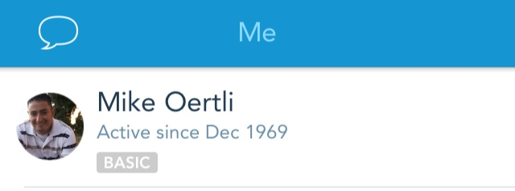
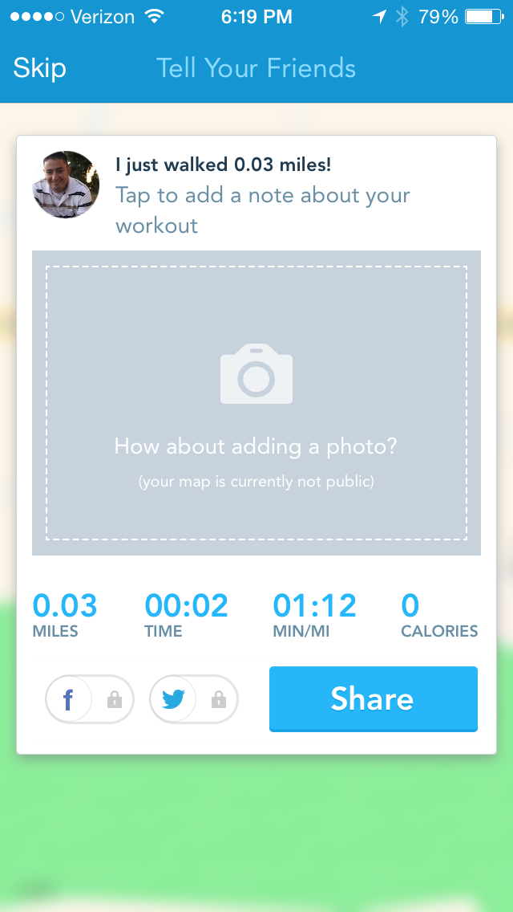

Update 2 (9/27): RunKeeper's updates this week reversed course on this, sharing is no longer an extra tap if you always bypass it! It sounds so dumb, but **it is genuinely appreciated**! 

 

458 activities. 851 miles. So much beautiful data... it is all as good as gone. Let me back up a few steps. I really enjoy data. I have tracked every mile, minute spent in my car, and thousandth of a gallon of gas put into my car, all because I love data. I have used RunKeeper for years to do the same with my walking. In fact, I have been a member since 1969 according to their records, who am I to argue that? 

Alright, that *might* be a bug, just possibly, but why am I throwing this data away?

Simply put, my priorities as a RunKeeper user have been eclipsed by the priorities of the company. Now, admittedly, I'm not a very valuable user to them because they do offer so much at the free tier, but I still believe that the user should matter. None of my complaints would be remedied by becoming a paid member, so that option is out.

For many months I have been hoping to gain a feature where "recently used" contacts appearing at the top of the list when tagging people in an activity (not social media, just including them so their RunKeeper stats reflect the activity recorded by my phone).  I contacted them about it after several months of frustration and received a "we'll see what we can do." Sadly no progress as of yet.

> [@OpTechMike](https://twitter.com/OpTechMike) Thanks for the feature request!! We will see what we can do! <http://t.co/EWFnSXp5kO>
>
> — RunKeeper Support (@RKSupport) [February 3, 2014](https://twitter.com/RKSupport/statuses/430395065706369024)

Tagging my wife by searching for her name is an annoyance, but nothing more.

However, a recent update added a "feature" that prompts the user for social media sharing on every single event. This is even present **despite the fact that I have no social networks connected to the app**. I am not the only one who is unhappy about the update, there are several feature requests with many up-votes and comments on each <a href="http://support.runkeeper.com/hc/communities/public/questions/202760966-permanently-disable-the-share-screen-" target="_blank">here</a>, <a href="http://support.runkeeper.com/hc/communities/public/questions/201327623-Turn-off-the-share-prompt-after-an-activity-is-completed" target="_blank">here</a>, <a href="http://support.runkeeper.com/hc/communities/public/questions/201293753-Turn-off-Tell-Your-Friends-Share-function-" target="_blank">and here</a>.

If the user has connected social media accounts, this might make sense, but only if there is a "never show this again" option. With no accounts connected this isn't only annoying, it is highly illogical. It sends the message that RunKeeper will do anything to get you to post the spammy "I just completed a walk!" messages to your feed. 

I went poking around the settings menu hoping to find an option to disable this, there isn't one. What I did find, though, are 2 prompts to rate the app – one at the top of the settings menu and one at the bottom. Again, they are putting their own needs ahead of the user.

To be perfectly clear, every app should have a link to leave a review, and I prefer this over the popup prompt that inspired Gruber's rants, but their implementation is annoying.

It isn't the end of the world, and I understand that complaining about a free app and free service is rather petty on my part. These frustrations have inspired me to begin shopping around for alternatives. Nike+, MapMyWalk, and others are on my radar, but I certainly welcome feedback and recommendations. I am happy to spend money, though I'd prefer to buy an app than to pay a monthly fee.

I hope RunKeeper changes their mind. Their brand is nearly ubiquitous so the self-centered behavior of the app seems senseless. I have enjoyed the rich feature set and general interaction with the app to this point; though not perfect it more than met my needs.

**Update**: I don't like the step backward in the user experience, but it has become clear why they can get away with it - there isn't anything better right now. Nike is focused solely on running. Map My Walk has a clunky UI, multiple prompts to upgrade, needless push notifications, and ad banners. There are others, but [none seem to be able to dethrone RunKeeper](http://appcrawlr.com/app/uberGrid/265767). So for now, the solution is to suck it up.
