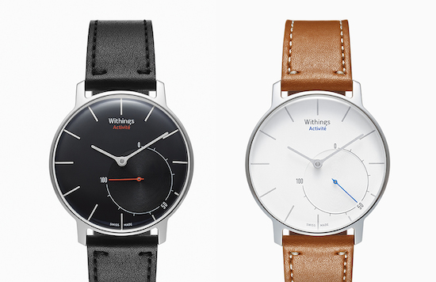

The new [Withings Activité](http://www.withings.com/activite/en-US) smart watch is beautiful, unlike many of the other entrants to the market.

The first thing that stands out to me is how clearly different the approach to creating this product must have been. If you take Samsung, LG, or even Pebble (I'll talk about Motorola in a moment) it is pretty obvious they started with a list of features and built the watch around it. Withings has undoubtedly started with a simple and timeless watch design and added intelligence to it. These two approaches are worlds apart.

How?

The Activité gets 1 year of battery life. Pebble et al. gets 3-7 days. The Activité could be worn on a first date (this is [Bradley Chambers' rule of thumb](https://twitter.com/bradleychambers/status/481922920219148288) for smart watch design, and I love it), the others... not so much. On the flip side, the Activité doesn't have the wide range of features found in the competition, but a feature checklist is never a good design guide for something like this.

I have stopped wearing my Pebble because it was bulky and unattractive as a time piece. I think time and unit sales will confirm this, but an elegant complement to the smartphone that people already love is vastly more appealing than a miniature smartphone strapped to the wrist. The biggest problem here is the price (\$390), but that'll come down over time; not to mention people that are able will happily pay for high quality and beautiful products that appeal to them.

The Moto 360 looks to be an attempted hybrid between looks and features. I think Motorola is on the right track, but the watch is still quite thick, it is decidedly masculine, and the battery life isn't quite where we'd like to see it (even if it doesn't last a year). 

The looming question surrounding smart watches is "what problem do they solve?" With the Withings Activité looking like an elegant and classic timepiece, that question might be demoted in importance just enough to kick start the wearables movement beyond the early adopter market. By starting with design instead of features, Withings has shown a light on what might become a mass market product category. I wouldn't bet my lunch money on it, but there is very little doubt that it is a step in the right direction.
