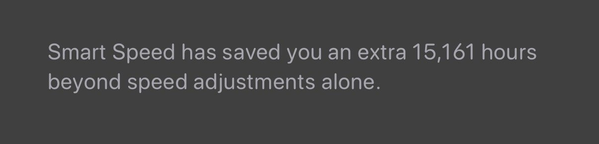

This page is for sharing some of my picks. Podcasts, products, apps, and whatever else I think is worth sharing.

## Podcasts

I listen to a lot of podcasts, but even more than that, I listen to audiobooks. Using a combination of buying credits and monitoring deals on Audible, I purchase books relentlessly and then maintain my own library with the help of <a href="https://openaudible.org/" target="_blank">OpenAudible</a> and some custom software to provide a password-protected feed of my library. Taking this approach – rather than using the Audible app – lets me benefit from the unrivaled Smart Speed feature of <a href="https://overcast.fm/" target="_blank">Overcast</a> and save amounts of time that can be hard to fully appreciate.

For example, this is as of January 1, 2026:

My Overcast Smart Speed statistics as of January 1, 2026.

### Tech

- [The Talk Show](http://www.muleradio.net/thetalkshow/) (Weekly, 2 hours) - John Gruber discusses Apple and surrounding topics with a guest each week. He gets side tracked on baseball from time to time, but always entertaining.

- [Accidental Tech Podcast](http://atp.fm) (ATP) (Weekly, 2 hours) - Marco Arment, John Siracusa, and Casey Liss (of who the hell is Casey Liss fame) discuss Apple, technology, and the tech industry. Really fun dynamic between the three of them.

- [Dithering](https://dithering.fm) (MWF, 15 minutes) - Ben Thompson and John Gruber have regular, concise conversations about the tech industry. Subscription required.

- [WVFRM](https://podcasts.apple.com/us/podcast/id1474429475) ([MKBHD](https://www.youtube.com/user/marquesbrownlee)’s Podcast) - Marques is a video guru that mostly does tech reviews, but has hundreds of incredible videos. His podcast is also great!

- [Cyber](https://www.vice.com/en/topic/cyber?series=krkbn6), [Malicious Life](https://malicious.life), [Darknet Diaries](https://darknetdiaries.com/), and [Hackable](https://hackablepodcast.com/) - Fascinating stories about hacking, cybersecurity, pen-testing, and more.

- [Privacy and OSINT Podcast](https://inteltechniques.com/podcast.html) - I deeply miss this podcast, but alas I don’t think it is coming back. It was a podcast with great insight on remaining anonymous (or at least protected) in a connected world.

- [Grumpy Old Geeks](https://www.gog.show) - Fun podcast for those that remember the earlier days of the internet.

- <a href="https://www.ridehome.info/show/techmeme-ride-home" target="_blank">TechBrew Ride Home</a> - Formerly the TechMeme Ride home, but still a great overview of what is going on in the tech world.

- [Home Assistant](https://hasspodcast.io) - A podcast about the increasingly powerful, and completely open, home automation platform.

- [Self Hosted](https://selfhosted.show) - RIP to this show, there are still some related podcasts from some of the same people like Linux After Dark and Linux Unplugged. This was a great show about open source and self-hosted software solutions, increasing ownership of our content and putting privacy back into our own hands.

- **Honorable Mention**: [Automators](https://www.relay.fm/automators), Mac Geek Gab, Clockwise, Hard Fork, The Rebound

### Non-Tech

- [Prof G Show with Scott Galloway](http://www.westwoodonepodcasts.com/pods/the-prof-g-show-with-scott-galloway/) - Similar to Pivot, except Scott is solo and/or with a guest. There is also a market-centric pod (Prof G Markets) and a political pod (Raging Moderates) that I deeply enjoy.

- <a href="https://acquired.fm" target="_blank">Acquired</a> - These guys put together detailed yet compelling background and analysis on the most successful companies of our time. It sounds like it would be dry, but truly each episode is a gem and absolutely worth every moment.

- [My First Million](https://www.mfmpod.com) - Interesting (sometimes controversial) discussions about starting/owning businesses, I enjoy the brainstorming on ideas aspect of this show in particular.

- [Pivot](https://podcasts.voxmedia.com/show/pivot) - Kara Swisher and Scott Galloway provide highly entertaining commentary and bold opinions on technology and the technology/startup industry.

- <a href="https://cms.megaphone.fm/channel/TBIEA9794787572" target="_blank">This Car Pod!</a> - The team from carsandbids.com has a light-hearted car and automotive market/industry podcast that I find really entertaining.

- <a href="https://www.searchengine.show/" target="_blank">Search Engine</a> (a.k.a. Incognito Mode) and <a href="https://www.hyperfixedpod.com/" target="_blank">Hyperfixed</a> - individual podcasts from the former Reply All team.

- [Jordan Harbinger Show](https://www.jordanharbinger.com) - Despite being daily and 60m+, I have grown to really love this podcast. Jordan is relatable, humble, and an outstanding interviewer.

- <a href="http://www.npr.org/podcasts/510311/embedded" target="_blank">Embedded</a> (30-60 minutes) - Enthralling stories from reporters who dive deep into a culture or group of people, usually a very dangerous group.

- <a href="https://www.revealnews.org/episodes/" target="_blank">Reveal</a> (Weekly, 60 minutes) - From the Center for Investigative Reporting, uncovers perspectives and facts that often are overlooked in commonly reported stories, or fascinating aspects of things that have gone entirely unreported.

- <a href="https://opentodebate.org/" target="_blank">Open to Debate</a> and [Intelligence Squared](https://www.intelligencesquared.com) - Great debate to help you understand both sides of an argument, the ones you have a strongly held opinion on are the most interesting. Listen with an open mind!

- <a href="https://www.relay.fm/cortex" target="_blank">Cortex</a> - I don’t listen to this as much as I used to. I realized that CGP Grey’s uniquely thoughtful and entertaining perspective was a big part of why I loved this show, and his departure from the show is unfortunate.

- **Honorable Mention**: Infinite Monkey Cage, Criminal, [Hello Internet](http://www.hellointernet.fm/), The Important Thing, My Brother My Brother and Me, The Weekly Show with John Stewart, The Gargle, The Bugle, Analog(ue), 99% Invisible

 Leadership

- [The Important Thing](https://randsinrepose.com/archives/category/the-important-thing/) - Michael Lopp (@rands) podcast about leadership and other misc. topics.

- Some classic options that I don’t listen to as much as I used to, but may provide a useful backlog if nothing else:

  - [Manager Tools](https://www.manager-tools.com) - this is sort of the manager’s podcast, the starter pack of episodes is excellent if not looking for a more regularly published podcast.

  - [Programming Leadership](https://programmingleadership.podbean.com) - Marcus Blankenship’s podcast about leadership in the context of software development teams.

## Mobile Apps

I have around 388 apps on my phone as of writing, and use approximately 60-100 unique apps each week depending what I am doing. I have a tremendous appreciation for beautifully designed and appropriately functional apps. Here are some of my favorites (for iOS).

- [**Ivory**](https://tapbots.com/ivory/) - This is, without question, my Mastodon client of choice. I highly recommend this app and I have a lot of respect for their (small) team. I also really enjoy the (open source) [**Ice Cubes**](https://github.com/Dimillian/IceCubesApp) app and am an avid supporter of both. I don’t use Mastodon much, but really love this app so I maintain the subscription so that I can enjoy a beautiful design when I do. (RIP Tweetbot, their Twitter client that put them on my radar.)

- [**Overcast**](https://overcast.fm) - When I began my podcast journey in the 2010s, I started with the stock podcast player for the platform (typically Apple Podcasts). I never thought I needed more. *Enter: Overcast*. Smart speed, voice enhancements, and a beautiful UI. You're crazy if you don't at least check this out. As of early 2026, I crossed the 15,000 hour mark for time save by Smart Speed (does not include the base speed increase). It’s hard to overstate just how thankful I am for an app that can give me so much of my own time back.

- <a href="https://agilebits.com/onepassword" target="_blank"><strong>1Password</strong></a> - With how easy it is to use secure passwords across all of your devices, there is no excuse for not using a good password manager. There is none better than 1Password, I cannot recommend this product highly enough.

- [**Todoist**](https://todoist.com) - My wife and I share grocery lists, Costco lists, to-do lists, etc. We've found that Todoist has good syncing, 3rd party integration (ex: Siri and Alexa), sharing, features, design, and load time for our needs. I have strongly considered returning to iOS Reminders for this given how much that has improved… TBD.

- [**Evernote + Scannable + Fujitsu ScanSnap iX1300**](http://evernote.com/evernote/) - I have gone almost entirely paperless, so I use Evernote heavily. I also use it for taking notes to sync across devices. Scannable does a surprisingly good job of scanning documents in, I basically always use PDF, but it's quite good in general. I have tried the alternatives (like Notion, Craft, Obsidian, etc… see [this site for more](https://www.noteapps.info)) and just can’t find something that meets my needs.

- Home Assistant

- <a href="http://www.dueapp.com" target="_blank"><strong>Due</strong></a> - While \$5 seems like a lot for a timer/reminders app, I have found it well worthwhile. The custom tones and snoozing capabilities of this app are really useful, I find myself forgetting things far less often.

- <a href="http://streaksapp.com" target="_blank"><strong>Streaks</strong></a> - A very simple, yet useful and powerful, goal tracking app. I can't believe this is free.

- [**Tailscale**](https://tailscale.com) **-** A VPN that isn’t exactly a VPN, but is an absolute game-changer for anyone looking to securely and painlessly connect between devices from anywhere in the world.

- [**Screens**](https://edovia.com/en/) - An excellent VNC/remote desktop app for iOS and Mac.

- **Stock apps** - I really like the simplicity and speed of several stock apps also. Notes for quick and easy things, Reminders for my own to-do list, iMessage, Mail (iOS), Calendar, and more. I have tried several highly regarded replacements for these, but found that the stock apps did the job nicely.

- **iMessage** deserves its own call-out. I know there are sync issues between devices, but those used to be a lot worse than they are now (I use 4 devices with regularity - 2 Macs, iPhone, iPad). Generally speaking messages and messages being marked as read work perfectly as expected. iMessage feels so different than SMS. Part of it is internal bias of "blue bubbles" to be certain, but it just feels like an enjoyable communication experience. It's fast, media being sent is high enough quality, it's got great capabilities like leaving groups, muting alerts, finding/sharing location, and more. While challenigng to quanitify, I can safely say that iMessage is a genuine improvement to my life. I tried replacing it with SMS + Hangouts and would peg that experiences many orders of magnitude below iMessage. <a href="http://www.opte.ch/news/2015/02/03/messaging-speed-or-consistency-not-both" target="_blank">I have written</a> a bit about iMessage/Hangouts and the tradeoffs.

- Honorable mention: NordVPN, ChatGPT, Amazon, AutoSleep, Shortcuts, Wyze, Carrot Weather, Nomorobo, Clic, Relight, Tailor, Photomator, Bambu Studio

 

## macOS Apps

- <a href="http://bjango.com/mac/istatmenus/" target="_blank"><strong>iStat Menus</strong></a> - Places the most useful information in your status bar. Thoroughly configurable and incredibly useful, all for a very reasonable price. \[\$18\]

- **VPN** - I used to love Cloak (rebranded to Encrypt.me), but it has gotten shady and does not score well on privacy. Proton VPN is one option, but it lacks the “auto-connect on unknown networks” that I loved so much with Cloak. I’ve used NordVPN lately, but definitely don’t love everything about it. Tailscale is the only “always” in my VPN category.

- [**VS Code**](https://code.visualstudio.com) - A really nice text editor that is very customizable, but usable right out of the box. I have started to notice some bloat and have to respect the murmured concerns about analytics etc. being shipped off to Microsoft, so the open source variant <a href="https://vscodium.com/" target="_blank">VSCodium</a> has started to catch my eye. \[Both are free\]

- <a href="https://slack.com" target="_blank"><strong>Slack</strong></a> - If you aren't using Slack for work, you should be. If you aren't using it for your social circles, you probably should be there too. \[Free\]

- <a href="https://ghostty.org/" target="_blank"><strong>Ghostty</strong></a> **-** Ghostty has replaced <a href="https://www.iterm2.com" target="_blank">iTerm</a> for me – it is more performant and lighterweight.  - If you use the command line at all, get Ghostty (free) and install oh my zsh. The ability to customize is endless but well documented and once you switch you'll never go back. I am using the <a href="https://starship.rs/" target="_blank">Starship prompt</a> (not to be confused with the Spaceship prompt) along with <a href="https://atuin.sh/" target="_blank">Atuin</a> and some other tools. I am obsessed with dotfiles and aliases etc, but haven’t yet taken the time to clean mine up such that they can be made public. \[Free\]

- <a href="http://brew.sh" target="_blank"><strong>Homebrew</strong></a> - Makes life a lot easier for installing and managing developer tools (among other things). \[Free\]

- <a href="http://www.bettertouchtool.net" target="_blank"><strong>Better Touch Tool (BTT)</strong></a> - Allows powerful customization of gestures, taps, clicks, and more for the touchpad, a Magic Mouse, or a regular mouse. You can supercharge the speed of your navigation by finding gestures that work for you beyond the system defaults and make your life a lot easier. \[Was a “Pay what you can” model when I purchased it, now I am not sure\]

- <a href="https://agilebits.com/onepassword" target="_blank"><strong>1Password</strong></a> - The perfect companion to the iOS app, 1Password is hands down the best way to manage your passwords and secure data. By using 1Password, it becomes much easier to use highly secure logins to all of your services by eliminating the need for you to remember tens or hundreds of passwords. \[\$50\]

- <a href="https://www.jetbrains.com/idea/" target="_blank"><strong>IntelliJ</strong></a> - An amazing development environment for Java work, even the free version is incredibly powerful and feature-rich. It has great documentation and help and receives regular updates.

- [**Fork**](https://fork.dev) - The best GUI git client I have ever seen.

- [**Pixelmator Pro**](https://www.pixelmator.com/pro/) - I am admittedly concerned what will happen here now that <a href="https://www.pixelmator.com/blog/2024/11/01/a-new-home-for-pixelmator/" target="_blank">Apple has purchased the Pixelmator team</a>, but I am really happy for them because they created such a compelling product. To a non-graphic-designer, this is just as good as Photoshop, but easier to use and way cheaper. Their guides are outstanding and I use this more often than I ever thought I would. It has gotten me out of several binds - for example, we needed to order something that had fixed dimensions for a photo, we had one candidate photo and it simply could not be cropped to those dimensions. Using the AI features, I was able to extend the (highly complex) photo background to extend the image and fit into the crop without anyone ever noticing that the trees and grass aren’t “real”. \[\$40\]

 

## My Setup

- **Computer**: 2021 MacBook Pro 16” M1 Max

- **Phone**: iPhone (usually the latest iPhone Pro (non-Max) variant

- **Tablet**: White iPad Pro 12.9” w/ Nano-texture

- **AirPods**: I can't imagine life without them anymore. If \$159 seems expensive – you haven't used them yet. I know most people will disagree, but I have the AirPods Pro as well and I prefer the non-Pro AirPods. They are much more comfortable to wear all day every day (I tend to leave 1 in most of the time).

- **Backup Strategy**:

  - 1st: TB4 NVMe SSD backups (soooo fast)

  - 2nd: [Backblaze](http://www.backblaze.com/) (\$5/month)

  - 3rd: [Time Capsule](https://www.apple.com/airport-time-capsule/) (2TB) technically still connected, but this is being phased out

  - 4th: Synology with TimeMachine and manual dupes of certain files.

  - 5th Infrequent [SuperDuper!](http://www.shirt-pocket.com/SuperDuper/superduperdescription.html) clones - I really don’t do this anymore even though I should…

 

## Useful Technology & ServiceS

For one reason or another, often due to trial and error, I've found some useful items that might not be well known. Other items in the list are just things I find useful and wanted to share. 

- <a href="http://www.apple.com/airpods/" target="_blank"><strong>AirPods</strong></a>  - Worth many times their \$159 asking price, AirPods are only second to my iPhone in favorite material objects I own. They are amazing for casual podcast/audiobook listening, non-audiophile music listening, working on projects at home (including very active ones), working out or walking the dog, or for conference calls at work. I've polled nearly everyone I've talked to on the phone (via voice call, Slack, call FaceTime, etc.) and found consistently perfectly quality, even in the face of daunting background noise. Their convenience is extraordinary and the ability to use a single earbud or both is something I take advantage of several times per day. With one or both in my hear for most of a waking ~17 hour day, I have never exhausted more than about 70% of the combined battery life between the pods and the case, and never been without at least one charged and ready to go. There is no product I recommend more highly than AirPods for iOS and/or Mac users (they work with any platform, but I cannot verify the experience). I have the AirPods and AirPods Pro, I prefer standard AirPods with no hesitation.

- [**Home Assistant**](https://www.home-assistant.io) - I have only begun to scratch the surface here, but when I looked at HASS a couple years ago, it was very clearly geared toward people who had time to deal with it. It still sort of is, but much less so. The community for HASS has flourished, and the flexibility and power of the platform continues to impress me.

- <a href="https://www.apple.com/apple-tv-4k/" target="_blank"><strong>Apple TV 4K</strong></a> - If you have a Mac, iPad, or iPhone, the Apple TV is a wonderful accessory. AirPlay works great and is really convenient. The new models are fast, Siri works really well, and for my basic usage, it is great. Feature for feature, there are good options for much less money, unless you want AirPlay.

- <a href="https://www.nespresso.com/us/en/order/machines/vertuo/vertuo-vertuoline-chrome-and-aeroccino-plus" target="_blank"><strong>Nespresso</strong></a> - If you prefer espresso or espresso-based drinks, these are worth every penny. At approximately \$0.70 per pod, it can seem expensive, but it's far cheaper than Starbucks or energy drinks. The environmental impact is not ideal because they do not support reusable pods like Keurig does. Make sure to buy the Vertuo line, not the Original line (Inissia), it is ***much*** quieter (the Inissia is weirdly loud) and it is the newer line so is more likely to have pods available for sale longer. I recommend the bundle with the milk frother, it's easy to wash and is the fastest, easiest, and cleanest way to get hot frothed milk for lattes.

- **Meh List**

  - ***Nest Thermostat* (Gen. 2)** - I have one, but would shop around now that the market is full of good options. To call this device "smart" is an injustice to the concept of even the most basic intelligence. It is little more than a wifi-enabled thermostat (that is aesthetically pleasing).

  - ***Chamberlain MyQ***  - I am on the fence here... The idea is great, and the execution isn't unbearable, but there are days (exceedingly rare now, it used to be 1+ per week) when I get anywhere from 1 to 20 false alarms, and it is super stressful when you're out of town. The app is unattractive and the reliability just isn't there. Also as you approach the house and start joining the wifi network, you get stuck in limbo of the door trying to open, but failing, then randomly processing the request some time later (sometimes 20+ minutes, meaning your garage might just open randomly after you've gone to bed).

    - **2020 Update**: The reliability and false-opening alerts have decreased to nearly zero. I am more bullish on this again…

    - **2025/26 Update**: I have completely abandoned this product line. There are highly intrusive advertisements within the app when trying to open my garage, the app is slow and often won’t connect despite strong connections for all of my products, and I just cannot support the user-hostile decisions that this company makes. Please explore open source and local-first variants like <a href="https://ratcloud.llc/" target="_blank">Ratgdo</a>.

##  

## Favorite Books/Artciles on Leadership or Business

- <a href="https://www.amazon.com/Predictable-Success-Getting-Organization-Track/dp/1608320316" target="_blank">Predictable Success</a> by <a href="https://twitter.com/lesmckeown" target="_blank">Les McKeown</a> - Defines a model for the stages of growth for a company with a focus on understanding the types of people and strengths help at each stage and understanding which of those can prevent you from attaining the next stage or be problematic once you get there. This is a must-read for leadership of companies that are going from a handful of employees to 25, 30, or 50.

- <a href="https://www.amazon.com/Start-Why-Leaders-Inspire-Everyone/dp/1591846447" target="_blank">Start With Why</a> by <a href="https://twitter.com/simonsinek" target="_blank">Simon Sinek</a> - Many will find this book hard to digest if they aren't developing a physical product or if they haven't been influenced by modern "Valley" startup culture, but it is a mistake to dismiss it, plus it is short enough to knock out at 1.5x on Audible. Simon discusses how the most successful companies sell *why* rather than *what*.

- <a href="https://www.amazon.com/Talking-Crazy-Irrational-Impossible-People/dp/1511364351" target="_blank">Talking to Crazy</a> by <a href="http://markgoulston.com" target="_blank">Mark Goulston</a> - Dr. Goulston provides an excellent framework for identifying and navigating conversations or relationships with "crazy" people. He defines crazy as behaving or speaking independently of logic or factual reality, something that (essentially) everyone is guilty of to a degree.

- [Principles by Ray Dalio](https://www.audible.com/pd/Principles-Audiobook/B074B29GQJ) - An outstanding resource on how to approach everything in life with an open mind, humility, and curiosity. It also includes some good “reality checks” to practice catching ourselves when we think we’re doing this, but really it.

- [No Rules Rules by Reed Hastings](https://www.audible.com/pd/No-Rules-Rules-Audiobook/1984891170) - A fascinating and informative perspective on how Reed has run his business, lessons learned along the way, and how a unique approach like his cannot be halfway adopted. I’m very curious what the reality of working for Netflix is… for example, the stated policy is that they’re completely ok with you taking other interviews, they just ask that you give them the specifics of the offer so they can determine if they can compete (and if they want to, and to keep their market rate data fresh), but I have a hard time believing that across the organization the human tendency toward feeling slighted (the all-too-common, yet terrifically misguided, “why wouldn’t they want to work for me!?” response), has been suppressed.

- Just about anything from <a href="http://randsinrepose.com/about/" target="_blank">Michael Lopp</a> (<a href="https://twitter.com/rands" target="_blank">@rands</a>), <a href="http://randsinrepose.com/archives/category/management/" target="_blank">here's a great list</a> to get you started.

- I enjoy [Camille Fournier’s thoughts](https://skamille.medium.com) on leadership.

- This list remains extremely outdated… sorry!
